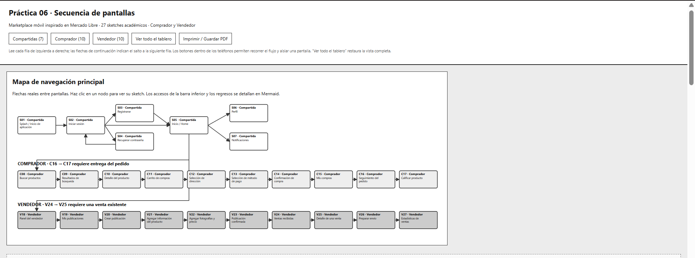
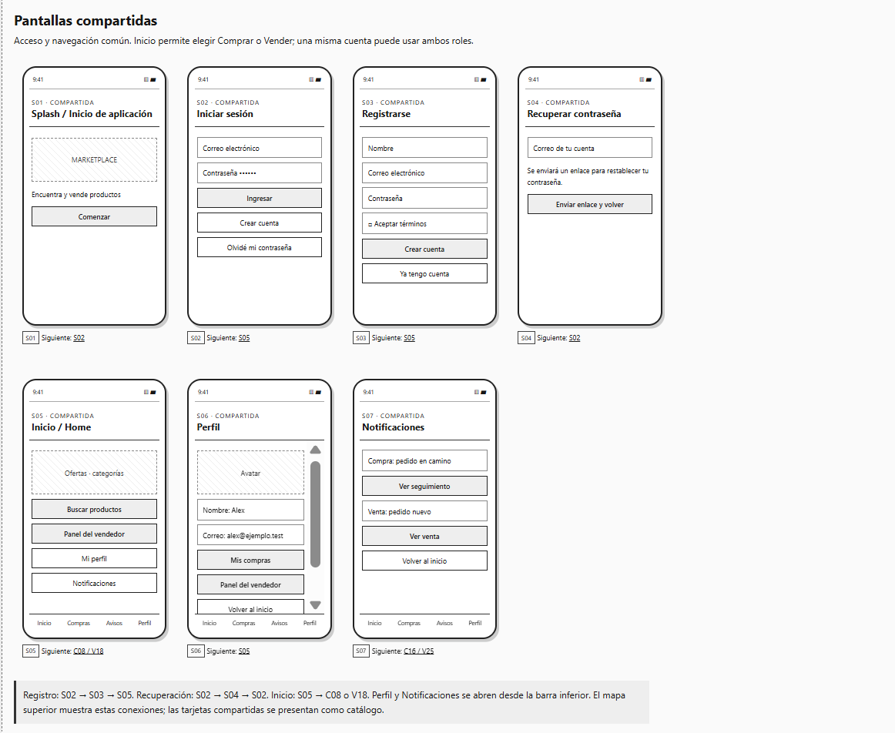
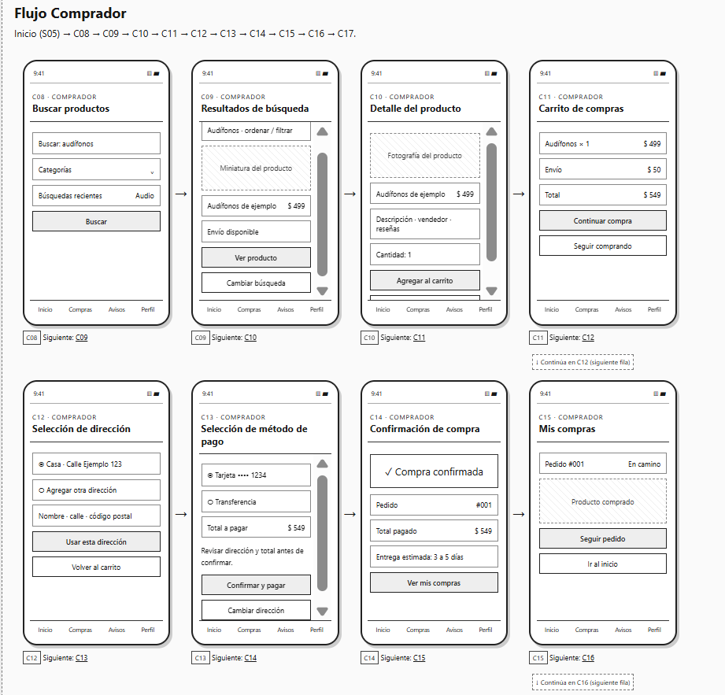
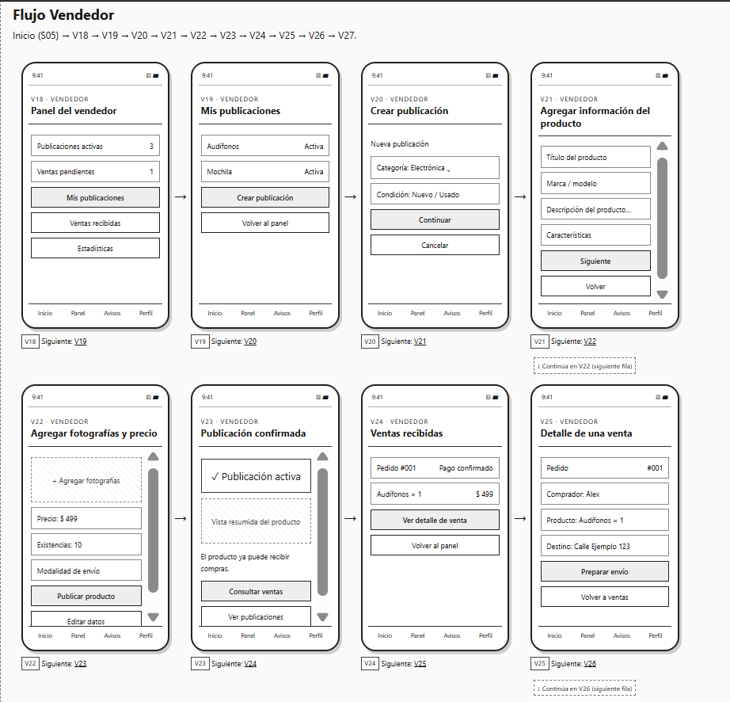

# Práctica 06: Diagrama de Secuencia de Pantallas

**Plataforma de referencia:** Mercado Libre.  
**Roles seleccionados:** Comprador y Vendedor.  
**Tipo de propuesta:** aplicación móvil de marketplace con sketches académicos de baja fidelidad.

## Objetivo

Representar la experiencia de usuario y la secuencia de navegación de una aplicación móvil con dos roles, identificando pantallas compartidas y específicas. La propuesta contiene **27 pantallas: 7 compartidas, 10 de Comprador y 10 de Vendedor**, superando el mínimo de 15.

El diseño utiliza blanco, negro y gris, teléfonos verticales, placeholders, botones simples y navegación inferior. Es una propuesta simplificada inspirada en las funciones de un marketplace; no reproduce la interfaz real de Mercado Libre.

## Descripción general del flujo

La persona abre la aplicación e inicia sesión; también puede registrarse o recuperar su contraseña. Desde Inicio elige comprar o acceder al panel del vendedor. Perfil y Notificaciones son compartidas. Una misma cuenta puede usar ambos roles.

**Comprador:** Splash → Iniciar sesión → Inicio → Buscar productos → Resultados → Detalle → Carrito → Dirección → Método de pago → Confirmación → Mis compras → Seguimiento → Calificar. La calificación requiere un pedido entregado.

**Vendedor:** Splash → Iniciar sesión → Inicio → Panel → Mis publicaciones → Crear publicación → Información del producto → Fotografías y precio → Publicación confirmada → Ventas recibidas → Detalle de venta → Preparar envío → Estadísticas. Consultar ventas después de publicar no supone que exista una venta inmediata.

## Lista de pantallas

Los IDs se conservan en sketches, Mermaid y contexto para Archify.

### Pantallas compartidas

| ID | Pantalla |
| --- | --- |
| S01 | Splash / Inicio de aplicación |
| S02 | Iniciar sesión |
| S03 | Registrarse |
| S04 | Recuperar contraseña |
| S05 | Inicio / Home |
| S06 | Perfil |
| S07 | Notificaciones |

### Pantallas del Comprador

| ID | Pantalla |
| --- | --- |
| C08 | Buscar productos |
| C09 | Resultados de búsqueda |
| C10 | Detalle del producto |
| C11 | Carrito de compras |
| C12 | Selección de dirección |
| C13 | Selección de método de pago |
| C14 | Confirmación de compra |
| C15 | Mis compras |
| C16 | Seguimiento del pedido |
| C17 | Calificar producto |

### Pantallas del Vendedor

| ID | Pantalla |
| --- | --- |
| V18 | Panel del vendedor |
| V19 | Mis publicaciones |
| V20 | Crear publicación |
| V21 | Agregar información del producto |
| V22 | Agregar fotografías y precio |
| V23 | Publicación confirmada |
| V24 | Ventas recibidas |
| V25 | Detalle de una venta |
| V26 | Preparar envío |
| V27 | Estadísticas de ventas |

## Archivos del proyecto

```text
Practica06/
├── README.md
├── diagramas/
│   └── flujo_pantallas.md
├── sketches/
│   ├── index.html
│   ├── styles.css
│   └── app.js
└── docs/
    ├── contexto_archify.md
    └── evidencias.md
```

Abrir [sketches/index.html](sketches/index.html) en el navegador para visualizar todas las pantallas. El tablero separa los tres grupos y conecta el recorrido principal con flechas. Sus botones permiten recorrer pantallas individuales; “Ver todo el tablero” restaura el conjunto. No necesita instalación, servidor ni conexión a Internet.

Consultar [el diagrama Mermaid](diagramas/flujo_pantallas.md) para las rutas principales, regresos y accesos comunes. Consultar [la guía de evidencias](docs/evidencias.md) para capturas, impresión y publicación.

## Evidencias de la práctica

Completar estos espacios con tus capturas. Puedes guardarlas en `docs/capturas/` y agregar cada imagen con ``.

### Captura del tablero general



### Capturas de pantallas compartidas



### Capturas del flujo Comprador


### Capturas del flujo Vendedor




### Enlace de GitHub Pages

> **URL de esta práctica:** [Enlace de GitHub Pages](https://ktmich2095.github.io/Practicas_Integradora_230881/Practica06)

## Material para Archify

Proporcionar [diagramas/flujo_pantallas.md](diagramas/flujo_pantallas.md) y [docs/contexto_archify.md](docs/contexto_archify.md). Agregar los tres archivos de `sketches/` o capturas del tablero como referencia visual, y este README como presentación. El documento de contexto contiene una indicación lista para generar posteriormente el diagrama interactivo.

## Alcance

Es un prototipo de navegación, con datos ficticios y controles ilustrativos. No procesa registros, compras, pagos o envíos. Los recorridos muestran escenarios exitosos y rutas de regreso; no modelan todos los errores de una aplicación final.
