# Navegación completa de pantallas

27 pantallas móviles: 7 compartidas (S), 10 de Comprador (C) y 10 de Vendedor (V). Cada nodo es una pantalla. Las flechas continuas representan avance o acceso directo; las discontinuas representan regreso y navegación global. Los grupos, prefijos y tonos grises distinguen roles sin depender del color.

```mermaid
flowchart TD
    subgraph COM["Pantallas compartidas · 7"]
        S01["S01 · Splash / Inicio de aplicación"]
        S02["S02 · Iniciar sesión"]
        S03["S03 · Registrarse"]
        S04["S04 · Recuperar contraseña"]
        S05["S05 · Inicio / Home"]
        S06["S06 · Perfil"]
        S07["S07 · Notificaciones"]
    end
    subgraph BUY["Flujo Comprador · 10"]
        C08["C08 · Buscar productos"]
        C09["C09 · Resultados de búsqueda"]
        C10["C10 · Detalle del producto"]
        C11["C11 · Carrito de compras"]
        C12["C12 · Selección de dirección"]
        C13["C13 · Selección de método de pago"]
        C14["C14 · Confirmación de compra"]
        C15["C15 · Mis compras"]
        C16["C16 · Seguimiento del pedido"]
        C17["C17 · Calificar producto"]
    end
    subgraph SELL["Flujo Vendedor · 10"]
        V18["V18 · Panel del vendedor"]
        V19["V19 · Mis publicaciones"]
        V20["V20 · Crear publicación"]
        V21["V21 · Agregar información del producto"]
        V22["V22 · Agregar fotografías y precio"]
        V23["V23 · Publicación confirmada"]
        V24["V24 · Ventas recibidas"]
        V25["V25 · Detalle de una venta"]
        V26["V26 · Preparar envío"]
        V27["V27 · Estadísticas de ventas"]
    end

    S01 -->|Comenzar| S02
    S02 -->|Ingresar| S05
    S02 -->|Crear cuenta| S03
    S03 -->|Registro exitoso| S05
    S03 -.->|Ya tengo cuenta| S02
    S02 -->|Olvidé mi contraseña| S04
    S04 -.->|Enviar enlace y volver| S02
    S05 -->|Comprar| C08
    S05 -->|Vender| V18
    S05 --> S06
    S05 --> S07
    S06 -.->|Volver| S05
    S06 -.->|Cerrar sesión| S02
    S06 -->|Mis compras| C15
    S06 -->|Panel del vendedor| V18
    S07 -.->|Volver| S05
    S07 -->|Aviso de compra| C16
    S07 -->|Aviso de venta| V25

    C08 -->|Buscar| C09
    C09 -->|Ver producto| C10
    C10 -->|Agregar al carrito| C11
    C11 -->|Continuar| C12
    C12 -->|Usar dirección| C13
    C13 -->|Confirmar y pagar| C14
    C14 -->|Ver compras| C15
    C15 -->|Seguir pedido| C16
    C16 -->|Solo con pedido entregado| C17
    C17 -.->|Enviar calificación| C15
    C09 -.->|Cambiar búsqueda| C08
    C10 -.->|Resultados| C09
    C11 -.->|Seguir comprando| C08
    C12 -.->|Carrito| C11
    C13 -.->|Cambiar dirección| C12
    C16 -.->|Mis compras| C15

    V18 --> V19
    V19 --> V20
    V20 --> V21
    V21 --> V22
    V22 -->|Publicar| V23
    V23 -->|Consultar lista de ventas| V24
    V24 -->|Seleccionar venta existente| V25
    V25 -->|Preparar envío| V26
    V26 -->|Registrar despacho y consultar| V27
    V18 -->|Ventas| V24
    V18 -->|Estadísticas| V27
    V19 -.-> V18
    V20 -.->|Cancelar| V19
    V21 -.->|Volver| V20
    V22 -.->|Editar datos| V21
    V23 -.->|Mis publicaciones| V19
    V24 -.-> V18
    V25 -.-> V24
    V26 -.-> V25
    V27 -.-> V18

    %% Barra inferior: nodos autenticados de ambos roles.
    C08 & C09 & C10 & C11 & C12 & C13 & C14 & C15 & C16 & C17 -.->|Barra: Inicio / Perfil / Avisos| S05 & S06 & S07
    V18 & V19 & V20 & V21 & V22 & V23 & V24 & V25 & V26 & V27 -.->|Barra: Inicio / Perfil / Avisos| S05 & S06 & S07
    C08 & C09 & C10 & C11 & C12 & C13 & C14 & C16 & C17 -.->|Barra: Compras| C15
    V19 & V20 & V21 & V22 & V23 & V24 & V25 & V26 & V27 -.->|Barra: Panel| V18
    S05 & S06 & S07 -.->|Barra: Compras| C15
    S06 -.->|Barra: Avisos| S07
    S07 -.->|Barra: Perfil| S06

    classDef shared fill:#fff,stroke:#111,stroke-width:2px,color:#111;
    classDef buyer fill:#eee,stroke:#111,stroke-width:2px,color:#111;
    classDef seller fill:#ccc,stroke:#111,stroke-width:2px,color:#111;
    class S01,S02,S03,S04,S05,S06,S07 shared;
    class C08,C09,C10,C11,C12,C13,C14,C15,C16,C17 buyer;
    class V18,V19,V20,V21,V22,V23,V24,V25,V26,V27 seller;
```

## Cómo leerlo

El acceso principal es S01 → S02 → S05. El registro y recuperación son ramas opcionales. Inicio permite cambiar de actividad sin requerir otra cuenta.

Comprador: S05 → C08 → C09 → C10 → C11 → C12 → C13 → C14 → C15 → C16 → C17. La última transición requiere entrega; la acción en el sketch representa ese momento.

Vendedor: S05 → V18 → V19 → V20 → V21 → V22 → V23 → V24 → V25 → V26 → V27. Una publicación puede consultarse inmediatamente; una venta depende de que un comprador la realice. El recorrido usa una venta de ejemplo ya pagada.

La barra inferior ofrece Inicio, Compras (Comprador) o Panel (Vendedor), Avisos y Perfil. Se omiten los enlaces a la misma pantalla. En los sketches el atajo del Vendedor se rotula Panel para reflejar su destino V18.

El diagrama completo incluye todos los accesos comunes y por ello tiene muchas conexiones. En Archify pueden ocultarse temporalmente los regresos y accesos globales para explorar los recorridos principales. Las aristas con varios orígenes y destinos (`&`) abrevían accesos independientes, no pasos obligatorios.

Referencia de reglas y solicitud para Archify: [contexto_archify.md](../docs/contexto_archify.md).
